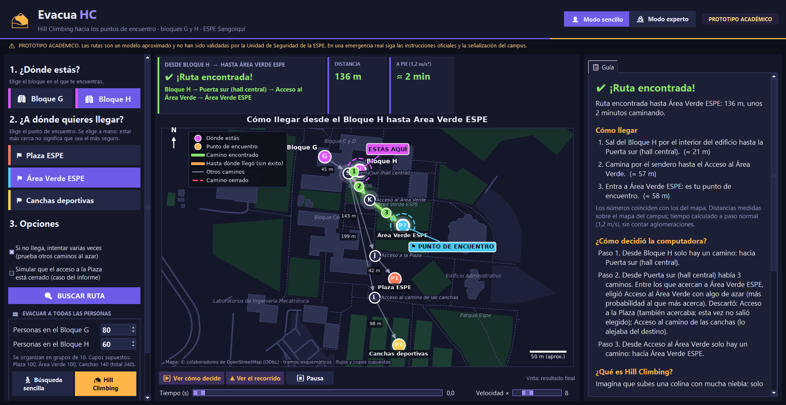
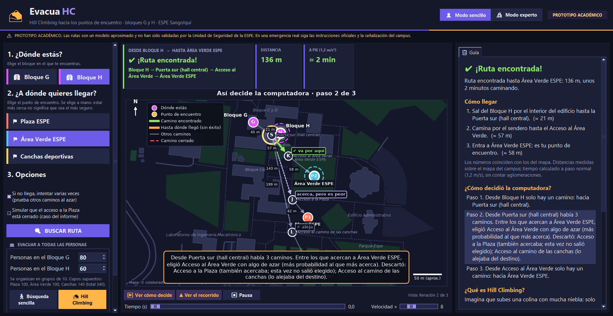
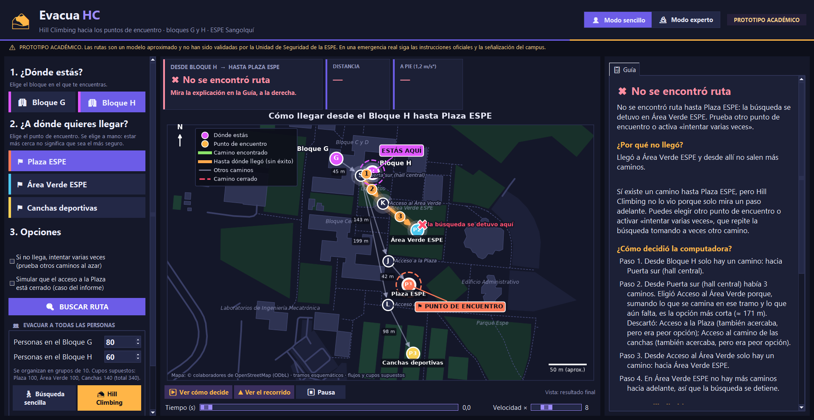
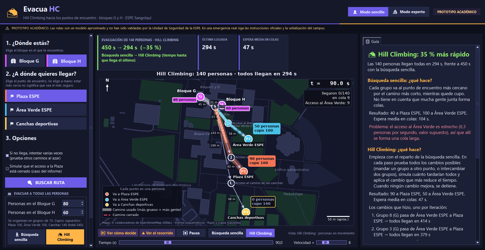
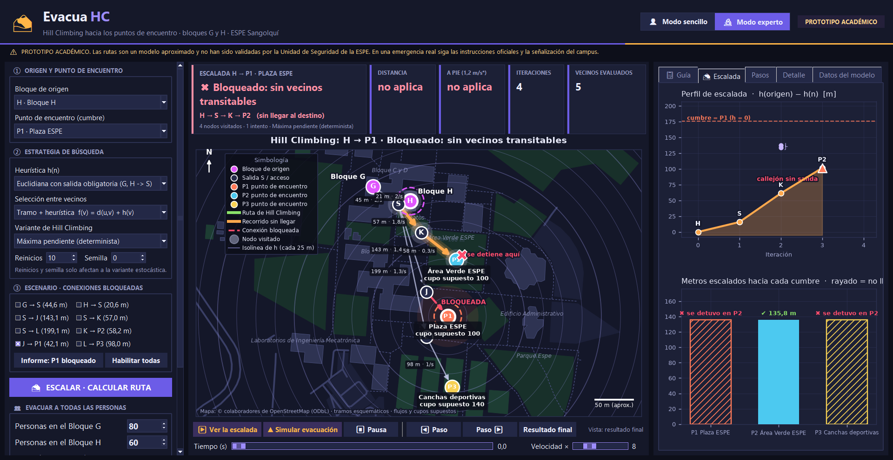
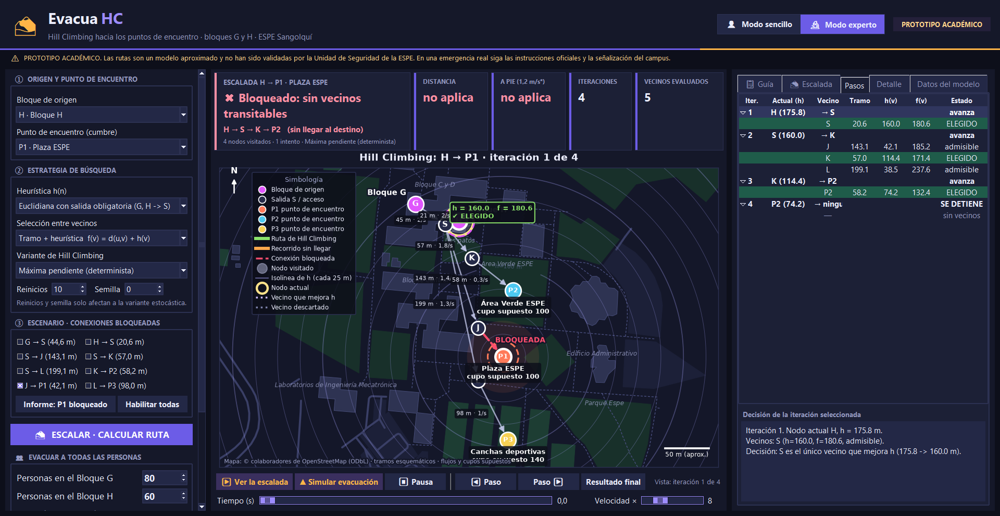
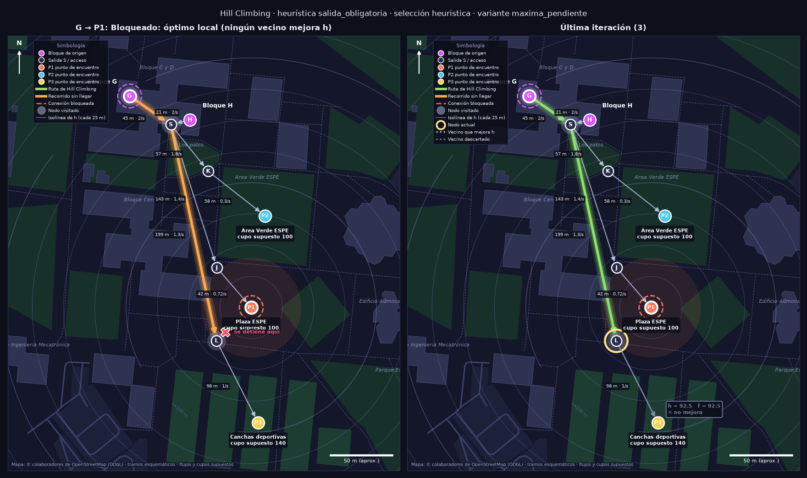
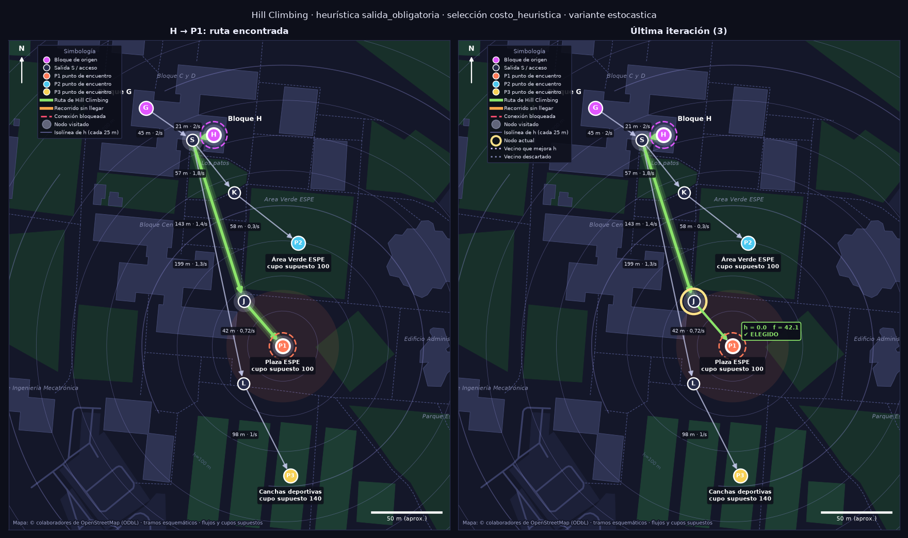
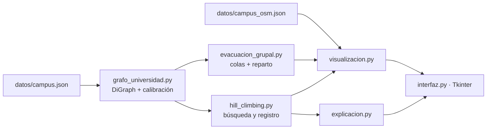

# EvacuaHC · rutas de evacuación con Hill Climbing

Aplicación de escritorio en Python que busca rutas de evacuación desde los bloques G y H de la Universidad de las Fuerzas Armadas ESPE (campus Sangolquí) hasta tres puntos de encuentro. Usa **Hill Climbing** sobre un grafo de **NetworkX** y muestra cada decisión del algoritmo sobre un mapa real de **OpenStreetMap**, en una interfaz **Tkinter + Matplotlib**.

    

> ⚠️ **Prototipo académico.** Las rutas son un modelo aproximado y no han sido validadas por la Unidad de Seguridad de la ESPE. No es un sistema de evacuación certificado. En una emergencia real siga las instrucciones oficiales y la señalización del campus.

| | |
|---|---|
| **Problema** | Las personas de los bloques G y H deben llegar a un punto de encuentro. Esos bloques no tienen puerta propia: se sale por el interior hasta la puerta sur del hall central y desde allí por senderos |
| **Objetivo** | Implementar Hill Climbing sobre el grafo documentado del campus y **mostrar con transparencia tanto sus aciertos como sus bloqueos** (óptimos locales, callejones sin salida), además de optimizar el reparto de 140 personas entre los puntos de encuentro |
| **Estado** | ✅ Funcional. 44/44 pruebas y autoprueba de la interfaz superada (2026-10-28) |
| **Autor** | Edgar Damian Toscano Coro · Estudiante de Ingeniería de Software · Universidad de las Fuerzas Armadas ESPE |

## Contenido

[Capturas](#capturas) · [Funcionalidades](#funcionalidades) · [Tecnologías](#tecnologías) · [Arquitectura](#arquitectura) · [Modelo de datos](#modelo-de-datos) · [Algoritmo](#el-algoritmo) · [Seguridad](#seguridad-y-uso-responsable) · [Instalación](#instalación-y-ejecución-local) · [Pruebas](#pruebas-y-validación) · [Limitaciones](#limitaciones-y-mejoras-futuras) · [Autoría](#autoría-y-créditos)

La documentación técnica completa (procedencia de cada dato, calibración, heurísticas, comparación con Búsqueda Tabú y detalle de la interfaz) está en [`docs/DISENO_TECNICO.md`](docs/DISENO_TECNICO.md).

## Capturas

Generadas el 2026-10-28 con `python main.py --autoprueba` y `python main.py --evidencias`, a partir del código de este repositorio.

**Modo sencillo:** pensado para quien no conoce el algoritmo.

| Ruta encontrada con indicaciones tipo GPS | «¿Cómo decidió la computadora?» |
|---|---|
|  |  |

| Sin ruta: explica por qué no llegó | Evacuación de 140 personas: Hill Climbing reduce el tiempo un 35 % |
|---|---|
|  |  |

**Modo experto:** heurística, criterio, variante, reinicios y bloqueos configurables.

| Acceso a la Plaza bloqueado | Tabla de iteraciones con h(v), f(v) y estado de cada vecino |
|---|---|
|  |  |

**Figuras generadas:** la limitación de la búsqueda local y cómo la supera la variante estocástica.

| Máxima pendiente: se detiene en un óptimo local | Estocástico con reinicios: llega al destino |
|---|---|
|  |  |

## Funcionalidades

| Funcionalidad | Cómo se usa | Resultado | Restricciones |
|---|---|---|---|
| Ruta de una persona | Elegir el bloque (G/H) y el punto de encuentro (Plaza, Área Verde, Canchas) → **Buscar ruta** | Ruta, distancia, tiempo a pie e indicaciones paso a paso, o el motivo exacto por el que no llegó | Hill Climbing no garantiza encontrar la ruta ni la más corta (es su naturaleza) |
| Ver la escalada | **Ver cómo decide** / **Ver la escalada** | Animación de cada iteración con los vecinos evaluados, `h` y `f` | — |
| Simular el recorrido | **Ver el recorrido** | Avance a 1,2 m/s con reloj | Solo tiempo de marcha |
| Bloqueos | Casillas de conexión o escenario «acceso a la Plaza cerrado» | El tramo se dibuja en rojo y nunca se usa | Escenarios fijos |
| Variantes del algoritmo (modo experto) | Máxima pendiente o estocástico con reinicios y semilla | Comparación reproducible | — |
| Evacuación de todas las personas | Número de personas en G y H → **Búsqueda sencilla** o **Hill Climbing** | Reparto por punto de encuentro, tiempo de la última llegada, colas y animación | Modelo de colas con flujos y cupos supuestos |
| Perfil de escalada y comparación P1-P3 | Pestaña **Escalada** | Altura ganada por iteración, «cima falsa» o «callejón» | No recomienda el punto «más seguro» |
| Funcionamiento sin conexión | Automático | Mapa base desde `datos/campus_osm.json` | `mapa_osm.py --descargar` requiere Internet |

## Tecnologías

| Categoría | Tecnología | Uso |
|---|---|---|
| Lenguaje | Python 3 (probado con 3.13) | Toda la aplicación |
| Grafos | NetworkX | Grafo dirigido del campus (`DiGraph`) |
| Visualización | Matplotlib (+ NumPy) | Mapa, grafo, isolíneas de la heurística, animaciones y gráficas; ajuste por mínimos cuadrados de la calibración |
| Interfaz | Tkinter / ttk | Ventana de escritorio con modo sencillo y modo experto |
| Datos geográficos | OpenStreetMap (API Overpass, copia local) | Mapa base: edificios, áreas verdes, senderos |
| Pruebas | `unittest` (biblioteca estándar) | 44 pruebas |

## Arquitectura

```
evacuahc-hill-climbing/
├── main.py                 Entrada: interfaz, --evidencias, --autoprueba
├── interfaz.py             Ventana Tkinter; conecta algoritmo y figuras
├── hill_climbing.py        Algoritmo, heurísticas y variantes (núcleo)
├── grafo_universidad.py    Carga de datos, calibración píxel→metros y construcción del grafo
├── evacuacion_grupal.py    Reparto de personas, simulación de colas y Hill Climbing de reparto
├── explicacion.py          Textos en lenguaje sencillo generados a partir del resultado real
├── visualizacion.py        Dibujo: mapa, grafo, pasos, animación y gráficas
├── mapa_osm.py             Mapa base de OpenStreetMap (copia local y descarga opcional)
├── modelos.py              Dataclasses del registro de búsqueda
├── configuracion.py        Rutas, constantes, colores y textos
├── datos/                  campus.json (grafo), campus_osm.json (mapa) y README de procedencia
├── tests/                  44 pruebas (unittest)
└── docs/                   Diseño técnico y capturas
```



El algoritmo **no depende de la interfaz**: `hill_climbing.py` devuelve un registro completo de la búsqueda (`modelos.py`) que luego consumen la visualización, las explicaciones y las pruebas.

## Modelo de datos

No hay base de datos: el modelo es un **grafo dirigido** cargado desde `datos/campus.json`.

```
G ──44,6──┐
          ├─> S ──57,0──> K ──58,2──> P2 Área Verde
H ──20,6──┘   ├──143,1──> J ──42,1──> P1 Plaza
              └──199,1──> L ──98,0──> P3 Canchas
```

| Elemento | Atributos |
|---|---|
| **Nodos** (9) | `id`, `nombre`, `tipo` (origen, salida, acceso, destino), posición en metros `x`, `y`, `lat`/`lon` cuando se conocen, si la posición está documentada o estimada, `cupo_supuesto` |
| **Aristas** (8, dirigidas en sentido de evacuación) | `longitud_m`, `flujo_supuesto`, `tipo`, `transitable` |
| **Escenarios** | Lista de aristas bloqueadas (p. ej., J → P1) |

Las posiciones de G, H, S, K, J y L se **estimaron** con una calibración píxel → metros (error RMS ≈ 0,3 m) usando P1-P3 como puntos de control. La procedencia de cada dato está en [`datos/README.md`](datos/README.md).

## El algoritmo

- **Estado:** el nodo actual. **Valor:** `h(n)`, distancia estimada en metros al destino (menor es mejor).
- **Movimiento:** solo a vecinos por aristas transitables que **mejoren estrictamente** `h`; se elige el de menor `f(v) = h(v)` o `f(v) = d(u,v) + h(v)`.
- **Parada:** destino alcanzado, **óptimo local** (ningún vecino mejora) o **callejón sin salida**.
- **Heurísticas:** euclidiana con salida obligatoria por la puerta S (por defecto) y euclidiana pura (para demostrar el óptimo local).
- **Variantes:** máxima pendiente (determinista) y estocástico con reinicios (semilla reproducible). Ninguna acepta empeorar ni usa memoria tabú.
- **Reparto de 140 personas:** Hill Climbing sobre asignaciones de grupos de 10, evaluando cada vecino con un modelo de colas; pasa de 449,8 s a 293,8 s (−35 %) en 5 iteraciones.

## Seguridad y uso responsable

Al ser una aplicación de escritorio sin red, usuarios ni base de datos, no aplican autenticación, sesiones ni inyección SQL. Lo relevante es **no inducir a error**:

| Medida implementada | Detalle |
|---|---|
| Aviso permanente | Banner «PROTOTIPO ACADÉMICO» en la ventana y en este README |
| Sin falsas garantías | Una ruta calculada se presenta como *modelada*, nunca como *segura*; la cercanía no implica seguridad |
| Explicaciones fieles | Los textos del modo sencillo se generan a partir del registro real de la búsqueda (comprobado por `test_explicacion.py`) |
| Datos trazables | Cada dato indica si es documentado, estimado o supuesto |
| Sin secretos ni datos personales | No usa claves, cuentas ni información de personas |

**Pendiente antes de cualquier uso real:** planos vigentes, coordenadas medidas de todos los nodos, confirmación de los puntos de encuentro oficiales y validación institucional.

## Instalación y ejecución local

**Requisitos:** Python 3 con Tkinter (versión probada: 3.13; Tkinter viene incluido en el instalador oficial de Windows).

```bash
python -m venv .venv
.venv\Scripts\activate            # Linux/macOS: source .venv/bin/activate
python -m pip install -r requirements.txt

python main.py                    # aplicación
python -m unittest discover -s tests -v   # pruebas
python main.py --evidencias       # regenera las figuras en evidencias/ (sin ventana)
python main.py --autoprueba       # abre la ventana, la recorre, guarda capturas y se cierra
python mapa_osm.py --descargar    # opcional: vuelve a descargar el mapa base (requiere Internet)
```

| Problema | Solución |
|---|---|
| `ModuleNotFoundError: tkinter` | Instalar Python con Tcl/Tk (en Linux: `sudo apt install python3-tk`) |
| La pestaña «Croquis y mapas» muestra un aviso | Normal: esas imágenes son de terceros y no se incluyen (ver `datos/README.md`) |
| El mapa aparece sin fondo | Falta `datos/campus_osm.json` |

## Pruebas y validación

| Archivo | Pruebas | Qué cubre |
|---|---|---|
| `test_hill_climbing.py` | 18 | Grafos sintéticos: entradas inválidas, óptimo local, callejón, ciclos, límite de iteraciones, aristas bloqueadas, determinismo, variante estocástica |
| `test_grafo.py` | 12 | Datos reales: topología, longitudes frente al informe de referencia, calibración, bloqueos, rutas válidas, figura correcta |
| `test_evacuacion_grupal.py` | 9 | Conservación de personas, cupos, coincidencia con el informe, óptimo local real, intervalo mínimo de las colas, reproducibilidad |
| `test_explicacion.py` | 5 | Las indicaciones del modo sencillo coinciden con lo que hizo la búsqueda |
| **Total** | **44** | ✅ **44/44** (`python -m unittest discover -s tests`, 2026-10-28) |

**Validación de la interfaz:** `python main.py --autoprueba` abrió la ventana real, calculó H → P2 (ruta encontrada, 113,2 s de marcha), H → P1 sin reintentos (bloqueado), el reparto de 140 personas (449,8 s → 293,8 s) y el escenario con acceso bloqueado, y abrió la ventana de croquis sin las imágenes de terceros. No hay pruebas automatizadas de los eventos de la interfaz más allá de esta autoprueba.

## Limitaciones y mejoras futuras

- Hill Climbing puede detenerse en un óptimo local o en un callejón aunque exista camino, y no garantiza la ruta más corta (es la limitación que la aplicación busca mostrar).
- 6 de los 9 nodos tienen posición estimada; la heurística hereda ese error.
- Red pequeña: una sola ruta por par origen-destino.
- No modela densidad, movilidad reducida, escaleras, anchura física ni la evolución del peligro.
- Mejoras posibles: más nodos medidos en campo, comparación lado a lado con A* y Búsqueda Tabú, y exportación de resultados.

## Autoría y créditos

**Desarrollador: Edgar Damian Toscano Coro**
Estudiante de Ingeniería de Software
Universidad de las Fuerzas Armadas ESPE

Proyecto académico individual.

**Fuentes de datos (no son código de este repositorio):**
- Topología, longitudes, escenarios y modelo de colas: informe *Sistema inteligente de optimización de rutas de evacuación para los bloques G y H mediante Búsqueda Tabú* (Flores, Bolaños y Gómez, 2026). Del simulador asociado solo se usó la referencia visual para medir la posición de los nodos; no se reutilizó su código ni su algoritmo.
- Mapa base: © colaboradores de OpenStreetMap, disponible bajo la [Open Database License (ODbL)](https://www.openstreetmap.org/copyright).
- Las imágenes «Plano Campus ESPE» (S. Valladares, 2017), el mapa de puntos de encuentro de Toulkeridis et al. (2019) y la captura del simulador Tabú pertenecen a sus autores y **no se incluyen** en este repositorio.

El código se distribuye bajo la [licencia MIT](LICENSE). Los datos de OpenStreetMap de `datos/campus_osm.json` mantienen su licencia ODbL.
